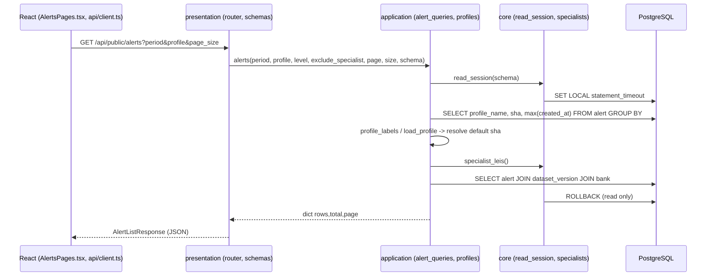

# AUD-1b — Call flow of the fixed code (read-only)

Date: 2026-11-25 · Code state: after AUD-2 (hooks, `load_panel`, upsert, split functions). Line numbers refer to the working tree.
Notation: `module.file:function (line)`. "DB" = PostgreSQL schema `public`, staging data in schema `staging`.
Depth is capped at 4; deeper helpers are summarised in one line.

---

## B1. Import of one EBA edition

**Trigger:** CLI `python -m scripts.data.import_data edition|all` (`scripts/data/import_data.py:main` 33). The API route `POST /api/imports` and the `stage`/`validate_data`/`load` worker job kinds run the same functions; here the script drives them in-process through `ImportWorker`.

### Call sequence

1. `scripts.data.import_data:main` (33) — parse args, `select_target` (sets `DATABASE_URL`), `make_import_worker` (`scripts/common.py`) → registers `stage`, `load`, `validate_data` handlers; loops over editions → `import_edition` (15). *Side effects:* env variables.
   1. `scripts.common:edition_files` — list files of the edition directory (README excluded). *Reads:* files.
   2. `eba_ingest.application.upload_service:enqueue_import` (75) — files → `import_id`. *Writes:* storage dir (content-addressed copies), DB.
      1. `upload_service:store_files` (40) — stream each file, SHA-256 + encoding detection (`infrastructure/storage/storage.py:store` 5), refuses > max size (`FileTooLarge`), refuses the same file twice in one call (`DuplicateFile`). *Writes:* `<storage>/<sha[:2]>/<sha>.<ext>` read-only copy.
      2. `upload_service:check_before_registering` (62) — user exists; **duplicate check:** `repositories.find_loaded_duplicate` (30): any source_file with the same sha256 in an import with status `loaded` → `DuplicateFile`. *Reads:* `source_file`, `import_batch`.
      3. `repositories.create_import` (40), `upload_service:register_files` (70) → `repositories.add_source_file` (45; file type from `domain/services/file_detector.classify_name`), `repositories.enqueue_job` (54, kind `stage`). *Writes:* `import_batch(status='uploaded', edition_label)`, `source_file`, `job`. **Transaction:** one connection, `commit` at the end of `enqueue_import`; on any error `rollback` + `remove_files` of the copies created by this call.
   3. `run_job(worker, stage_job_id)` (`scripts/common.py`) → `Worker.process_one` (`core/worker/worker.py` 154) → `claim` (116, `FOR UPDATE SKIP LOCKED`, status `processing`) → handler `eba_ingest.application.worker_handler:handle_stage` (13).
      1. `staging_service:process_import` (153) — one connection; `_process` (122) per file: `inspect_file` (45; header normalisation, `missing_required` columns, period/aggregate counts) then `stage_file` (85): adds an empty `label` column if absent, **normalises grouped-thousands amounts**, `infrastructure/staging/staging.create_and_copy` (COPY into `staging.f<file_id>`), `fill_period_report`. *Writes:* staging tables, `decision_log`/report via `repo.save_report`, `audit_log`, job + import status (`finish_job`, `set_import_status`: `rejected` if no data file). **Transaction:** one `commit` at the end of `process_import`; exception → `rollback`; `handle_stage` then marks the import `rejected` (`IngestError`) or `failed` (any other error) in a separate transaction and re-raises.
   4. `eba_processing.application.validation:enqueue_validation` (36) → job `validate_data`; `run_job` → `worker_handler:handle_validate_data` (9) → `validation:run_validation` (62) → 13 SQL rules `infrastructure/validation_sql:v01…v13` per staged file (dimension decoding is used by the rules through `_edition` (106) only to look up the edition; **dimension codes are not decoded at import**). *Writes:* validation report (`decision_log` step `validation_report`), `import_batch.status` `validated` (if `can_proceed`) or stays `uploaded`. **Transaction:** one `commit`; error → `rollback`, re-raise.
   5. `eba_ingest.application.load_service:enqueue_load` (62) → `_check_load_status` (17: status must be `validated`/`approved`, or a retry of a failed load) → job `load`; `run_job` → `register_handlers` lambda → `load_service:run_load` (81).
      1. `run_load` — locks the import row (`FOR UPDATE`), status `loading`, calls `load_executor:_load` (120), writes `decision_log` `load_report`, **commit**; then separately drops the staging tables unless `EBA_DROP_STAGING_AFTER_LOAD=false` (`repositories.drop_staging_tables` 139; failure here is **swallowed**, `staging_dropped=false`).
      2. `load_executor:_load` (recipe, 45 lines; was 356) calls, in order:
         - `_lock_import` (status `FOR UPDATE`, `load_request` log) → `_plan`: data files, SDD/TR_Metadata paths (`_reference_files`), source hashes, staged vs fact column layout → `LoadError("schema-mismatch")`.
         - `_match_decisions`: `core/data_decisions:load_data_decisions` from `config/data_decisions.yaml`; `_decision_condition` builds the WHERE; a decision must match exactly 2 rows (exclude) or 1, else `LoadError`; logged later as `data_decision`.
         - `_check_preflight` → `core/preflight:collision_check` (recipe: `_exclusions`, `_collisions_of_file`): any collision → `LoadError("preflight-collisions…")`, nothing inserted.
         - `_merge_metadata_banks` (`_metadata` reads `TR_Metadata.xlsx`; a LEI history naming an existing bank merges into it), `_create_temp_tables`, then per data file `_file_exclusions` + `_register_banks` (new LEIs → `bank`, every staged LEI → `tmp_load_banks`).
         - per data file: `_create_versions` (**version activation**: `SELECT … is_active FOR UPDATE`; old version `is_active=false`; `version_no=max+1`; insert), `_resolve_items` (item dictionary: `indicator_code_map`; ambiguous → `LoadError`; unmapped items get an indicator and a map row via `_unmapped_indicator`), `_insert_facts` (`_refuse_conflicting_amounts`, `_fact_select_parts`, set-based `INSERT … SELECT DISTINCT ON … ON CONFLICT DO NOTHING`, per-file quality counters).
         - `_post_checks`: row count and amount sum of the loaded facts vs staged (`load-mismatch`); `dataset_version.quality`; `item_resolution` and `data_decision` logs; `import_batch.status='loaded'`.
         - **Known defect, preserved (AUD-2 finding):** the exclusion fragment applied in `_insert_facts` is the one computed for the *last* data file in the bank loop (a loop variable leaked into the insert loop), so owner exclusions of earlier files (e.g. BNG in `tr_cre`, 2020S) are logged as applied but not applied; prod `fact_cre` v14 still holds the BNG 2520501/2520502 rows.
   6. Errors in `run_load`: `rollback`, second connection sets `import_batch.status='failed'` (unless `loaded`), `UniqueViolation` is re-raised as `LoadError("duplicate-facts: <table>")`.

### Data objects

| object | main fields |
|---|---|
| `StoredFile` (`upload_service.py:18`) | name, sha256, size_bytes, path, encoding |
| `SourceFileRow` (`repositories.py:14`) | file_id, name, size_bytes, sha256, file_type, encoding, stored_path |
| `Inspection` / `FileReport` / `IngestReport` (`staging_service.py:35`, domain models) | columns, rows iterator, file_type, recognised, rows, aggregate_rows, pairs (year, quarter, banks, rows), warnings, staging_table; report: import_id, status, files, error |
| `Job` (`core/worker/registry.py:16`) | job_id, import_id, kind, attempts, schema |
| `DataDecision` (`core/data_decisions.py`) | id, file_type, action (`exclude`), dimensions, values |
| `ValidationReport` (`eba_processing/domain/models.py`) | import_id, files[FileValidation{issues[rule, severity, affected_rows]}], can_proceed |
| load result | `versions` (version_ids), `timings` |

### Sequence diagram

```mermaid
sequenceDiagram
  participant CLI as scripts/import_data
  participant APP as application (upload/staging/load/validation)
  participant DOM as domain (file_detector, decisions)
  participant INF as infrastructure (storage, repositories, staging SQL)
  participant DB as PostgreSQL
  CLI->>APP: enqueue_import(files, edition)
  APP->>INF: store_files (sha256, copy)
  APP->>INF: find_loaded_duplicate
  INF->>DB: SELECT source_file/import_batch
  APP->>INF: create_import, add_source_file, enqueue_job(stage)
  INF->>DB: INSERT import_batch, source_file, job; COMMIT
  CLI->>APP: Worker.process_one -> handle_stage
  APP->>DOM: classify_name, normalise_header, missing_required
  APP->>INF: create_and_copy (COPY to staging.f<id>)
  INF->>DB: CREATE/COPY staging; UPDATE job/import; COMMIT
  CLI->>APP: enqueue_validation -> run_validation (13 rules)
  APP->>DB: SELECT staging; INSERT decision_log; UPDATE import_batch=validated; COMMIT
  CLI->>APP: enqueue_load -> run_load -> _load
  APP->>DOM: load_data_decisions, collision_check
  APP->>DB: UPDATE old dataset_version is_active=false
  APP->>DB: INSERT dataset_version, bank, indicator, fact_* (ON CONFLICT DO NOTHING)
  APP->>DB: UPDATE import_batch=loaded; COMMIT
  APP->>DB: DROP staging tables (separate transaction)
```

### Errors and transactions

| step | boundary | raised | swallowed / converted |
|---|---|---|---|
| `enqueue_import` | 1 transaction (commit l.~95) | `FileTooLarge`, `DuplicateFile`, `IngestError` → files removed, rollback | none |
| `process_import` | 1 transaction | `UnreadableFile`/`IngestError` → import `rejected`; other → `failed` (separate connection) | job failure recorded by `Worker.process_one` (logged, not re-raised) |
| `run_validation` | 1 transaction | `NothingToValidate`, any → rollback | — |
| `run_load` | main transaction (lock → `_load` → commit); status `failed` in a second connection | `LoadError`, `UniqueViolation` → `duplicate-facts` | staging drop failure swallowed; `ON CONFLICT DO NOTHING` silently drops conflicting identical duplicates |
| `Worker.process_one` (`worker.py:154`) | job status updates in their own connections | — | handler exception → `mark_failed` + log; the caller sees only `True` |

---

## B2. Panel rebuild

**Trigger:** CLI `python -m scripts.data.build_reference panel --target test|prod` (`scripts/data/build_reference.py:build_panel_cmd` 32). Nothing in the API or the worker starts it.

### Call sequence

1. `build_reference:build_panel_cmd` (32) — `select_target`; `scripts.common:init_all_modules` (migrations of core and modules); `core.dimensions:build_dimensions("eba_prepared","config/dimensions")` — **rewrites** `config/dimensions/<edition>.yaml` from each edition's `TR_Metadata.xlsx` (reads files; writes yaml); `connect`; `build_panel(conn)`; close.
2. `core.panel:build_panel` (recipe, 27 lines; was 291): `with conn:` →
   1. `compute_panel(cur, …)` (read-only, in memory; also used by the golden check): `_active_versions` → `_context` (version → period/year/edition, bank LEIs) → `_base_rows` (rows = banks with any fact; `continuity_key` from `bank_crosswalk.yaml`; flags `group_crosswalk`, `specialist_institution` from `core/specialists:specialist_leis`) → `_load_facts` (needed items from `fact_oth/cre/sov`) → `_own_features` (per row: `_capital_ratios`, `_total_loans`, `_npl_ratio` with `_dimension_codes`, `_stage2_share`, `_roe` via `annualise_profit`, `_concentration` HHI) → `_growth_features` (`_quarterly_changes`, `_yearly_growth`; NULL + `series_break` across 2020-06-30) → `_flag_outliers` (MAD k=3, flag only) → `PanelBuild(rows, provenance)`.
   2. `_write_panel`: `DELETE FROM panel_row`; one INSERT per row from `panel_records(rows)` (values + flags + `build_provenance`). No active version → only `DELETE FROM panel_row`. **Commit.**
   3. **After the commit** `core/hooks.py:run_after_panel_rebuild(conn, PanelRebuilt(rows, version_ids))` runs every registered hook (registered at startup by `register_module_hooks(MODULES)` from each `ModuleSpec.after_panel_rebuild`): a failing hook is logged, the others still run, failures are raised together as `PanelHookError` (the panel is already committed). `build_panel(..., run_hooks=False)` skips them.
3. **Hook `eba_rules`** (`application/hooks.py:evaluate_active_profile`) → `evaluate_panel(conn, active_profile_name())` — flow B3 (alerts upserted, ids kept).
4. **Hook `eba_ml`** (`application/hooks.py:queue_score_jobs`): in its own transaction `INSERT import_batch` placeholder + one `job(kind='score_panel', message='score_panel model=<id>')` per champion. `core/panel.py` no longer contains any ML or rules code or table name (test `test_panel_single_reader.py`).
5. The queued `score_panel` job is processed by a running worker: `eba_ml.application.worker_handlers:_score` (recipe, 30 lines; steps `_select_champion`, `_load_scorer` (artifact sha verified in `ArtifactStore.load_model`, `build_dataset`, `_build_explainer`), `_score_rows` (R0 via `eba_rules.public.r0_alert`, `_shap_payload`), `_store_top_share`); panel rows come from `load_panel`.

### Data objects

| object | main fields |
|---|---|
| row dict in `compute_panel` | version_id, bank_id, continuity_key, `_flags{feature:[…]}`, frequency, 11 features, npl_delta_qoq, cet1_delta_qoq, `_loan`, sovereign_template |
| `provenance` | builder `core.panel`, `active_version_ids`, `configuration_sha256` |
| `panel_row` | version_id, bank_id, features, deltas, `flags` jsonb (per feature list + `frequency`, `sovereign_template`), `build_provenance` |

### Sequence diagram

```mermaid
sequenceDiagram
  participant CLI as scripts/build_reference
  participant CORE as app.core (dimensions, panel, specialists)
  participant DB as PostgreSQL
  participant W as worker
  participant ML as eba_ml application
  CLI->>CORE: init_all_modules, build_dimensions (files -> config/dimensions)
  CLI->>CORE: build_panel(conn)
  CORE->>CORE: specialist_leis, approved crosswalks, config hash
  CORE->>DB: SELECT dataset_version(is_active), fact_oth/cre/sov
  CORE->>CORE: ratios, NPL, RoCET1, HHI, flags, growth, outliers
  CORE->>DB: DELETE panel_row; INSERT panel_row x N
  CORE->>DB: SELECT ml_model champion; INSERT import_batch, job(score_panel)
  CORE->>DB: COMMIT
  W->>ML: score_panel job -> _score
  ML->>DB: SELECT panel_row; DELETE/INSERT ml_prediction; COMMIT
```

### Errors and transactions

Single transaction around the panel computation and write (`with conn:`): any exception rolls back, `panel_row` keeps the old content. Hooks run after the commit, each in its own transaction. `ValueError("unknown panel flag")` for a misspelt flag; missing dimension yaml → empty code sets → NPL `NULL` (silent: `_dimension_codes` returns `set()` when the file is absent). No swallowed exceptions. Hooks cannot roll the panel back; their failures surface as `PanelHookError`.

---

## B3. Rule evaluation

**Trigger:** (a) worker job kind `evaluate_rules` (`eba_rules.application.handler:register_handlers`, handler l.17-26; **no code enqueues it** in the repository); (b) CLI `python -m scripts.data.build_reference rules --profile <name> --target …` (`build_reference.py:evaluate_rules_cmd` 49); (c) thesis scripts call `eba_rules.public.evaluate_rows`/`load_profile` directly.

### Call sequence

1. `eba_rules.public:evaluate_panel` (re-export) = `application/evaluate.py:evaluate_panel` (18) — `profile_name=None` → active profile; `persist=True`.
   1. `application/profiles.py:load_profile` (55): `module_config` (25: reads `config/module.yaml`, strict keys) → `profile_entry` (47) → read profile file bytes → SHA-256; **frozen profile: sha must equal `module.yaml`** else `ProfileIntegrityError`; `yaml.safe_load`; `domain/profile_schema.py:validate_profile` (73) (unknown keys, rule types, feature names, thresholds, exactly one composite rule; helpers `_validate_rule` 27, `_validate_component` 49, `_validate_composite` 66); name/version/frozen must match `module.yaml`. *Reads:* two yaml files. *Returns:* `(profile dict, sha256)`.
   2. `with conn:` (transaction) → `core/panel_reader.py:load_panel` (the only reader of `panel_row`): standard rows `bank_id, period, frequency, dataset_version, 14 indicators, flags, is_specialist`.
   3. `application/evaluate.py:evaluate_rows` (12): `validate_profile` again → `domain/alert_level.py:evaluate_rows` (59):
      1. `domain/rule_evaluation.py:PanelIndex.build` (18-31) — by (bank, period), sorted periods, specialist bank ids (rows whose `flags.cet1_ratio` contains `specialist_institution`).
      2. per row, per non-composite rule: `alert_level.py:rule_result` (16) →
         - `rule_evaluation.py:evaluate_rule` (140) → `_level` (89: threshold or bands via `band_of` 60), `_trend` (97: `_comparison_period` 73, series-break guard, change = value − prior), `_persistence` (111: `_previous_half_year` 81, condition true now and half a year ago, series-break guard), `_relative` (124: percentile of same-period non-specialist cross-section) → `Outcome(triggered, not_evaluated, threshold, input_flags, tested_value)`; `_condition` (47) evaluates `below/above/decrease_over/increase_over`.
         - `rule_severity` (169) and `rule_family` (153) → severity 0-3, family.
         - result dict: `rule_id, input_value, triggered, not_evaluated, input_flags, threshold, severity, family` (+ `feature_value` for trend rules).
      3. `alert_level.py:family_scores` (26): per family the maximum severity of evaluated rules.
      4. `REQUIRED_INPUTS` missing → `missing` list; `alert_level.alert_level` (40): specialist → `not_evaluated`; required input missing → `not_evaluated`; none scored → `not_evaluated`; regulatory (3) or ≥2 families ≥2 → `red`; summed score ≥2 → `amber`; else `green` → `(level, reason, score)`.
      5. composite result row + `{"bank_id","version_id","score","level","rule_results":{rules, family_scores, level_reason}}`.
   4. `alert_repository.py:replace_alerts`: `INSERT … ON CONFLICT (profile_sha256, version_id, bank_id) DO UPDATE` per result (**alert_ids are kept**), then `DELETE` of this sha's rows whose (version, bank) is no longer produced. **Commit** on leaving `with conn:`.
2. `handler.py`: `connect(job.schema)`, `evaluate_panel`, `progress("evaluated N alerts", 99)`; connection closed in `finally`.

### Data objects

| object | main fields |
|---|---|
| profile dict | profile, version, frozen, defaults (inert), rules[{id, type, feature, condition, threshold/bands/percentile/periods, family, …}], conversion |
| `PanelIndex` (`rule_evaluation.py:18`) | standard rows (`load_panel`), by_key{(bank, period): row}, periods, specialists |
| `Outcome` (`rule_evaluation.py:34`) | triggered, not_evaluated, threshold, input_flags, tested_value |
| rule result | rule_id, input_value, feature_value (trend), triggered, not_evaluated, input_flags, threshold, severity, family |
| alert result | bank_id, dataset_version, score, level, rule_results{rules, family_scores{family:{score, rule_id, not_evaluated}}, level_reason} |

### Sequence diagram

```mermaid
sequenceDiagram
  participant E as entry (public.evaluate_panel / job handler)
  participant APP as application (profiles, evaluate)
  participant DOM as domain (schema, rule_evaluation, alert_level)
  participant INF as infrastructure (alert_repository)
  participant DB as PostgreSQL
  E->>APP: evaluate_panel(conn, profile)
  APP->>APP: load_profile (module.yaml, sha256 check)
  APP->>DOM: validate_profile
  APP->>INF: load_panel (core)
  INF->>DB: SELECT panel_row JOIN dataset_version (is_active)
  APP->>DOM: evaluate_rows(profile, rows)
  DOM->>DOM: rule_result -> evaluate_rule -> severity/family
  DOM->>DOM: family_scores -> alert_level
  APP->>INF: replace_alerts(profile_sha256, results)
  INF->>DB: UPSERT alert (sha, version, bank); DELETE vanished rows
  APP->>DB: COMMIT
```

### Errors and transactions

One transaction (`with conn:` in `evaluate_panel`): upserts and deletes commit together or roll back together. `ProfileIntegrityError`/`ValueError` from the loader propagate before any DB write; an unsupported condition raises `ValueError` mid-evaluation (rollback, no partial alert set). No exception is swallowed. The handler lets errors reach `Worker.process_one`, which records `failed`.

---

## B4. Reading alerts

**Trigger:** API requests `GET /api/public/alerts/profiles`, `/alerts/summary`, `/alerts`, `/banks/{bank_id}/alerts`, `/alerts/{alert_id}` (router `eba_rules/presentation/router.py:build_router` 18; mounted by `app/main.py` through `ModuleSpec eba_rules`). Caller in the UI: `webstorm/eba-ingest-ui`.

### Call sequence (typical: list alerts of one period)

1. React `pages/AlertsPages.tsx:AlertsHeatmapPage` (66) → `useProfiles` (36): `api.alertProfiles()` (`api/client.ts:103`) → `latestEbaProfile` (13) picks the default; then `api.alertSummary(profile.sha)` (104) for the periods and `fetchAllAlerts` (54) → `api.alerts({period, profile: sha, exclude_specialist, page, page_size: 1000})` (105) per period.
2. FastAPI `router.py:list_alerts` (36) — validates query (`period` length 6, `page ≥ 1`, `page_size ≤ 1000`; violation → 422 problem+json).
3. `application/alert_queries.py:alerts` (127): `validate_page` (12); period/level checks (`InvalidParameter` → 422);
   1. `core/read_session.py:read_session` (21): new connection, `SET LOCAL statement_timeout=10s`, always `rollback` + close; `QueryCanceled` → `QueryTooSlow` (504).
   2. `_resolve_profile` (46): `_available_profiles` (23: `SELECT profile_name, profile_sha256, max(created_at) FROM alert GROUP BY …` + `profile_labels` (profiles.py 101: registered files + `historical_profiles`)); no `profile` → active profile (`active_profile_name`, `load_profile` → sha; the newest-by-creation rule is gone); registered name → its sha; sha/prefix → match; none → `NotFoundError` listing available sets; ambiguous prefix → `BadRequestError`.
   3. `core/specialists:specialist_leis` (11).
   4. `SELECT a.alert_id, a.bank_id, b.lei, b.name, period, a.level, a.score, a.rule_results FROM alert a JOIN dataset_version v JOIN bank b WHERE profile_name, profile_sha256, period [, level] ORDER BY level rank, score DESC, name` (SQL inline in the application service).
   5. Python filter of specialist LEIs (`exclude_specialist`), slicing for the page, `_alert_projection` (76) → `{alert_id, bank_id, lei, bank_name, period, level, reason, family_scores}`.
4. Response validated against `presentation/schemas.py:AlertListResponse` (rows[AlertListItem], total, page, page_size).
5. Other routes: `alert_profiles` (84: list of sets with `version/frozen` from the sha labels, `rule_count`), `alert_summary` (103: per period counts/shares, specialists always excluded), `bank_alerts` (156: timeline of one bank for the resolved set), `alert_detail` (173: one alert with all rule results, `profile_version` from the sha label; optional `profile` check → 404 if the alert belongs to another set).
6. Rendering: `AlertsOverviewPage` (44) → stacked `AreaChart` of level shares per period; `AlertsHeatmapPage` (66) → bank × period grid of `LevelBadge`-coloured links to `/alerts/:id`; `BankAlertsTab` (78; used by `PublicPages.tsx:7`, bank page) → `LineChart` of family scores + strip + table (period, level, reason); `AlertDetailPage` (86) → level, reason, profile name/version/sha, family scores and the **rule table** (Rule, Family, Input = `input_value`, Threshold, Severity, Status = `triggered`, Flags).

### Data objects

| object | main fields |
|---|---|
| `AlertProfile` | profile_name, version, sha, frozen, created_at, rule_count, families |
| `AlertListItem` | alert_id, bank_id, lei, bank_name, period (YYYYMM), level, reason, family_scores |
| `AlertSummaryResponse` | profile_name, profile_sha256, periods[{period, counts, shares}] |
| `BankAlerts` | bank_id, rows[{period, level, reason, family_scores, …}] |
| `AlertDetail` | alert_id, bank_id, version_id, period, level, score, reason, family_scores, rules[…], profile_name, profile_version, profile_sha256 |
| stored `rule_results` | `{rules:[…], family_scores:{…}, level_reason}` (older sets may store a bare list; `_payload_fields` handles both) |

### Sequence diagram



### Errors and transactions

Read-only: no writes; `read_session` always rolls back and closes. `AppError` subclasses (`NotFoundError` 404, `InvalidParameter` 422, `BadRequestError` 400, `QueryTooSlow` 504) become `application/problem+json` through `core/api/errors.py`; unexpected exceptions become a generic 500 without detail. `ProfileIntegrityError` (edited frozen profile) is now an `AppError` (kind `profile-integrity`, HTTP 409): a tampered frozen profile gives a problem+json error `frozen profile <name> was modified: sha mismatch …`. Swallowed: none in this flow; the UI shows `ErrorBox` for failed requests.

---

## Public functions used across modules

| module | public functions used by other modules/scripts | users |
|---|---|---|
| `app.core.panel_reader` | `load_panel` (→ `PanelData{rows, panel_hash}`), `panel_hash`, `INDICATORS` | `eba_ml` (`dataset.build_dataset`, `worker_handlers._score`), `eba_rules` (`evaluate_panel`), `eba_public_analysis` (`panel.banks/bank_panel/cross_section`), `scripts/{figures,ml/event_evaluation,data/count_events}` |
| `app.core.hooks` | `register_module_hooks`, `register_after_panel_rebuild`, `run_after_panel_rebuild`, `PanelRebuilt`, `PanelHookError` | `app/main.py`, `app/worker.py`, `scripts/data/build_reference.py`, `core/panel.py` |
| `eba_rules.public` | `load_profile`, `evaluate_panel`, `evaluate_rows`, `regulatory_levels`, `r1_margin_grid_pp`, `r0_alert`, `r1_alert`, `compliant`, `choose_r1_margin`, `active_profile_name`, `ProfileIntegrityError` | `eba_ml` (labels, train, registry, worker_handlers), `scripts/hypotheses/*`, `scripts/ml/{event_evaluation,r1_margin_grid}`, `scripts/data/{build_reference,count_events}` |
| `app.core.specialists` | `specialist_leis` | `core/panel`, `eba_rules.application.alert_queries`, `eba_public_analysis.application.panel` |
| `app.core.read_session` | `read_session`, `QueryTooSlow` | `eba_rules`, `eba_public_analysis` (`eba_processing` has its own) |
| `app.core.panel` | `build_panel`, `compute_panel`, `panel_records` | `scripts/data/build_reference`, golden checks |
| `app.core.preflight` / `data_decisions` | `collision_check`, `load_data_decisions` | `eba_ingest.load_executor`, `eba_processing.validation_sql`, `scripts/data/preflight` |
| `eba_ingest`, `eba_processing` | `enqueue_import`, `enqueue_load`, `enqueue_validation`, `ImportWorker` | `scripts/common.py`, `scripts/data/*` |
| `eba_ml` | `build_dataset`, `train`, `model_factory`, `folds`, registry functions | `scripts/ml/*`, `scripts/hypotheses/*` |

---

## Report only: long functions, layer problems (after AUD-2)

**Functions longer than 50 lines on these flows:** none of the six reported in AUD-1b remain
(`_load` 356 → 45, `build_panel` 291 → 27, `build_dictionary` 272 → 48, `_score` 183 → 30, `collision_check` 67 → 14, `v02` 54 → 22).

**Resolved:** `core/panel.py` no longer writes ML tables or job kinds (hook registry); `panel_row` has one reader; `ProfileIntegrityError` is a problem+json error; alerts keep their ids; the default profile is the active one.

**Still open / report only:**
1. **Owner exclusions of earlier files are not applied at load** (`load_executor._load`, leaked loop variable; behaviour preserved, see B1) — data defect with a small effect on prod (BNG items 2520501/2520502 in 2019-12).
2. SQL inline in application services (`alert_queries`, `eba_ml._score`, `load_executor`).
3. `eba_processing/application/session.py:read_session` is a second implementation of the read session.
4. `eba_processing` writes `import_batch.status` (table owned by `eba_ingest`).
5. The worker job `evaluate_rules` is still never enqueued (the hook calls `evaluate_panel` directly).
