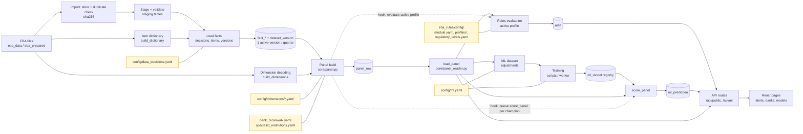

# Data flow — from EBA files to the React pages

State after AUD-2. Solid arrows = data flow, dashed arrows = hooks that run after a panel rebuild,
yellow nodes = configuration read by the node they touch.

(24 nodes: 19 processing/data nodes + 5 configuration notes; 31 edges: 23 data edges, 2 dashed hooks, 6 configuration links.)

## Node → code → tables → configuration

| node | code location | tables read / written | configuration used |
|---|---|---|---|
| EBA files | `eba_data/`, prepared by `scripts/data/audit_files.py:prepare` into `eba_prepared/<edition>/` | files only | — |
| Import: store + duplicate check | `eba_ingest/application/upload_service.py:enqueue_import` (75), `repositories.find_loaded_duplicate` (30) | reads `source_file`, `import_batch`; writes `import_batch`, `source_file`, `job`, storage dir | `EBA_STORAGE`, max upload size |
| Stage + validate | `staging_service.py:process_import` (153); `eba_processing/application/validation.py:run_validation` (62) | writes `staging.f<id>`, `decision_log`, `import_batch.status` | — |
| Load facts | `load_executor.py:_load` (recipe, ~45 lines; steps `_plan`, `_match_decisions`, `_create_versions`, `_resolve_items`, `_insert_facts`, `_post_checks`) via `load_service.py:run_load` (81) | reads staging, `indicator_code_map`, `bank`; writes `bank`, `indicator`, `dataset_version`, `fact_oth/cre/mrk/sov`, `decision_log` | `config/data_decisions.yaml` |
| fact_* + dataset_version | migrations `core/001_baseline.sql`, `004_fact_unique.sql` | — | one active version per (year, quarter): the latest import deactivates the previous |
| Item dictionary | `core/dictionary.py:build_dictionary` (recipe) via `scripts/data/build_reference.py dictionary` | reads SDD workbooks; writes `indicator`, `indicator_code_map` | `config/data_decisions.yaml` (`item_links`) |
| Dimension decoding | `core/dimensions.py:build_dimensions` via `build_reference.py dimensions/panel` | reads `TR_Metadata.xlsx`; writes `config/dimensions/<edition>.yaml` | — |
| Panel build | `core/panel.py:build_panel` → `compute_panel` (read-only, in memory) → `_write_panel`; hooks via `core/hooks.py` | reads `dataset_version`, `import_batch`, `fact_*`, `bank`, `indicator`; writes `panel_row` | `config/dimensions/*.yaml`, `config/bank_crosswalk.yaml`, `config/specialist_institutions.yaml` |
| panel_row | migrations `001_baseline.sql`, `010_panel_provenance.sql` | — | — |
| load_panel | `core/panel_reader.py:load_panel` (standard row, panel_hash) | reads `panel_row ⨝ dataset_version(is_active)` | — |
| Rules evaluation | `eba_rules/application/evaluate.py:evaluate_panel` → `domain/alert_level.py:evaluate_rows` | reads via `load_panel`; writes `alert` (upsert) | `eba_rules/config/module.yaml`, `profiles/eu_eba_v1.1.yaml`, `regulatory_levels.yaml` |
| alert | `011_alert.sql`; `alert_repository.py:replace_alerts` | unique (profile sha, dataset version, bank) | — |
| ML dataset | `eba_ml/application/dataset.py:build_dataset` | reads via `load_panel` | `config/ml.yaml`, `regulatory_levels.yaml` (R0 levels) |
| Training | `eba_ml/application/training/train.py:train`; `scripts/ml/train_thesis.py` | reads panel via `build_dataset`; writes run directory | `config/ml.yaml` |
| ml_model registry | `eba_ml/application/registry.py`, `service.py` | writes `ml_dataset`, `ml_experiment`, `ml_model`, artefact store | — |
| score_panel | `eba_ml/application/worker_handlers.py:_score` (recipe) | reads `ml_model`, `load_panel`; writes `ml_prediction`, `audit_log` | `config/ml.yaml` (`top_alert_share`) |
| ml_prediction | `012_ml.sql`, `013`, `014` | — | — |
| API routes | `eba_rules/presentation/router.py` (`/api/public/alerts*`), `eba_public_analysis/presentation/router.py`, `eba_ml/presentation/api.py` | read-only via `core/read_session.py` | `module.yaml` active profile |
| React pages | `webstorm/eba-ingest-ui/src/pages/AlertsPages.tsx`, `PublicPages.tsx`, `api/client.ts` | — | — |

Hooks: `ModuleSpec.after_panel_rebuild` of `eba_rules` (`application/hooks.py:evaluate_active_profile`) and `eba_ml`
(`application/hooks.py:queue_score_jobs`) are registered at startup by `core/hooks.py:register_module_hooks`
(API, worker, panel script) and run by `build_panel` after the panel transaction commits.

## Where the two branches diverge after `load_panel`

| | rules (`eba_rules`) | ML (`eba_ml`) |
|---|---|---|
| rows kept | all rows; specialists are `not_evaluated` through their flag | specialist rows dropped; `semiannual` grid keeps June/December |
| values | the 14 indicators as stored; missing required capital ratios → `not_evaluated` | the 11 `FEATURES`, plus peer rank, 12-month change, missing indicator |
| sample | every bank-period | R0-compliant rows with an evaluable forward label (E2/E3) |
| time logic | trend vs prior period (not across the NPL break), persistence vs previous half-year | forward labels t+12m; folds with embargo; operating point on OOF |
| output | `alert` (level, family scores, rule results) | `ml_prediction` (probability, alert, SHAP) |
